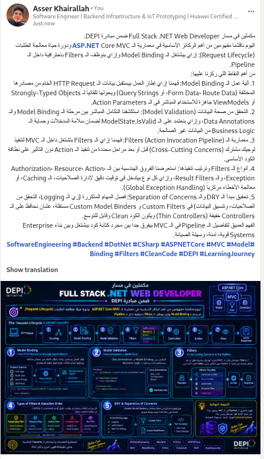

# MVC03 Assignment - Department CRUD, ViewModels, Architectural Boundaries, Filters & Model Binding

### 1. Practical Code (`SchoolApp`)
The solution (`MVC03_Workspace/SchoolApp`) targets .NET 8.0 and Entity Framework Core 8.0, demonstrating:
- **Code-First Database Modeling:** Complete entity configurations (`Department`, `Student`, `Course`, `Teacher`, and `StuCrsRes`) using Fluent API (`OnModelCreating`).
- **DepartmentController Lifecycle:**
  - `ShowAll`: Displays all departments along with total student counts.
  - `ShowDetails(int id)`: Projects domain entities into `DepartmentDetailsViewModel`.
  - `Add()` (`[HttpGet]` & `[HttpPost]`): Handles new department creation with model validation and anti-forgery token protection.
- **Custom ViewModel (`DepartmentDetailsViewModel`):**
  - Displays the department name and manager name.
  - Filters and populates a dropdown list (`SelectListItem`) of students exceeding 25 years of age.
  - Evaluates department state dynamically (`Main` if students count > 50, `Branch` if < 50).

### 2. Theoretical Report (PDF)
You can view the full theoretical report covering the 3 mandatory architectural cases for using ViewModels (including Security / Over-Posting mitigation) and Separation of Concerns (SoC):
- [View PDF on Google Drive](https://drive.google.com/file/d/1YYBUKqE5Dvm1Z6760y5ucCTYzdIGN1wO/view?usp=sharing)
- Local file in repository: `MVC03_ViewModels_Assignment_Report.pdf`

### 3. LinkedIn Technical Article (Filters & Model Binding in ASP.NET Core MVC)
- [View Post on LinkedIn](https://lnkd.in/p/ew5-BfSQ)

